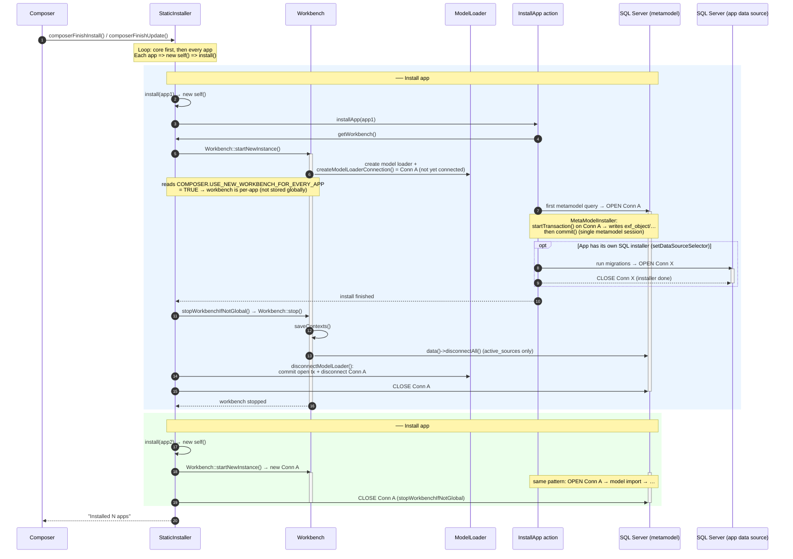
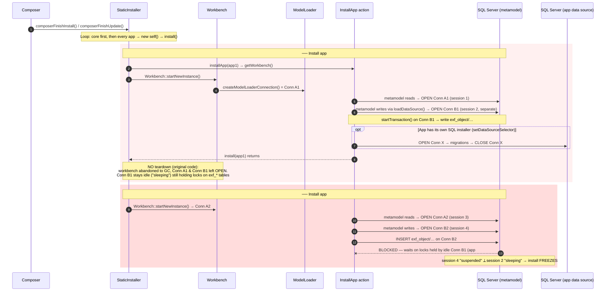

# StaticInstaller – workbench & DB connection flow

The diagram below shows, for the **default** setting
`COMPOSER.USE_NEW_WORKBENCH_FOR_EVERY_APP = TRUE`, when workbenches are
started/stopped and which database connections (SQL Server sessions) are
opened and closed during a Composer install/update run.

Legend for connections:

- **Conn A – metamodel connection**: created by `Workbench::start()` via
  `DataConnectionFactory::createModelLoaderConnection()` and given to the model
  loader. After the `SqlModelLoader` fix, the metamodel *data source* reuses
  this same connection, so **all metamodel reads and writes share one session**.
- **Conn X – app data-source connection**: a *separate* connection opened by an
  app's own SQL installer when it uses `setDataSourceSelector('0x…')` (e.g. an
  app with its own database). Apps that use `setDataConnection($modelConnection)`
  reuse Conn A instead.



## What changed to prevent the freeze

- **Before the fix:** the metamodel *writes* went through a **second**
  connection (Conn B) created by `SqlModelLoader::loadDataSource()`, separate
  from the model-loader connection (Conn A). Teardown only closed Conn A, so
  Conn B could be left **idle with an open transaction**, holding locks on the
  metamodel tables. The **next** app's install then **blocked** on those locks
  (the "sleeping" holder vs. "suspended" `INSERT` you observed) — which is why
  it hit the *second* app, not the first.
- **After the fix:** `SqlModelLoader` returns the model-loader connection for
  the metamodel connection UID, so metamodel reads **and** writes use a single
  session (Conn A). Teardown (`disconnectModelLoader()`) commits any open
  transaction and closes it, so nothing idle-with-open-transaction survives into
  the next app.

## TRUE mode — original code, without our changes (the freeze)

This shows the **unmodified** behaviour (before the `SqlModelLoader` fix and
before `stopWorkbenchIfNotGlobal()` / `disconnectModelLoader()`). With
`COMPOSER.USE_NEW_WORKBENCH_FOR_EVERY_APP = TRUE`, **every app gets its own new
workbench**, so every app opens a **new** pair of metamodel sessions: the
model-loader bootstrap connection (**Conn A**, reads) and a **separate**
connection from `SqlModelLoader::loadDataSource()` (**Conn B**, writes). There is
no teardown between apps, so app #1's Conn B is left **idle** ("sleeping") while
still holding locks on the metamodel tables. When app #2 starts a **fresh**
workbench and its **new** Conn B tries to write, it **blocks** on those leftover
locks — the install freezes. This is why it always hits the *second* app, not
the first.



## FALSE mode (single shared workbench) — original code, without our changes


This shows the **unmodified** behaviour (before the `SqlModelLoader` and
`disconnectModelLoader()` changes). With
`COMPOSER.USE_NEW_WORKBENCH_FOR_EVERY_APP = FALSE`, the first `getWorkbench()`
stores the workbench in `StaticInstaller::$globalWorkbench` and **all apps reuse
it**. The metamodel still uses **two** sessions — the model-loader bootstrap
connection (**Conn A**, reads) and a **separate** connection opened by
`SqlModelLoader::loadDataSource()` (**Conn B**, writes) — but because the
workbench is shared, Conn A and Conn B are opened **once** and reused for every
app. All metamodel writes therefore run on the **one** Conn B session, which
never blocks on its own (already-committed) locks, so there is no freeze.
`stopWorkbenchIfNotGlobal()` is a no-op; the connections are closed only when
the process ends.

```mermaid
sequenceDiagram
    autonumber
    participant SI as StaticInstaller
    participant WB as Workbench (global)
    participant ML as ModelLoader
    participant IA as InstallApp action
    participant DB as SQL Server (metamodel)
    participant AppDB as SQL Server (app data source)

    SI->>WB: getWorkbench() (app1) → Workbench::startNewInstance()<br/>[StaticInstaller.php:504 → Workbench.php:179→130]
    activate WB
    Note over SI,WB: config FALSE → stored in $globalWorkbench,<br/>reused for ALL apps [StaticInstaller.php:510]
    WB->>ML: createModelLoaderConnection() = Conn A (not yet connected)<br/>[Workbench.php:157 → DataConnectionFactory.php:172]<br/>setDataConnection() [Workbench.php:158]

    Note over SI,DB: ── Install app #1 ── [StaticInstaller.php:449 $action->installApp()]
    IA->>DB: first metamodel read → OPEN Conn A (session 1)<br/>lazy connect [AbstractDataConnector.php:286 → MsSqlConnector.php:186]
    activate DB
    IA->>DB: metamodel writes via loadDataSource() → OPEN Conn B (session 2, separate)<br/>[SqlModelLoader.php:725; new conn :843-844]
    Note over IA,DB: MetaModelInstaller: startTransaction() on Conn B →<br/>write exf_object/… → commit() (locks released)<br/>[MetaModelInstaller.php:178 … :200]
    opt App has its own SQL installer (setDataSourceSelector)
        IA->>AppDB: OPEN Conn X → migrations → CLOSE Conn X<br/>[AbstractSqlDatabaseInstaller.php:124, :134/:230/:286]
    end

    Note over SI,DB: ── Install app #2 … appN ──
    Note over IA,DB: SAME global workbench → reuse Conn A + Conn B.<br/>Every app's metamodel writes run on the one Conn B session,<br/>so it never blocks on its own (already-committed) locks → no freeze.

    Note over SI,WB: original code: no per-app teardown (install() just returns)
    SI-->>WB: process ends → CLOSE Conn A + Conn B (+ pooled Conn X)<br/>[AbstractDataConnector.php:312 → MsSqlConnector.php:227]
    deactivate DB
    deactivate WB
```

### Code references for the FALSE (old-code) diagram

| Operation in diagram | Source location |
| --- | --- |
| `getWorkbench()` → `Workbench::startNewInstance()` | `StaticInstaller.php:504` → `Workbench.php:179` → `start()` `Workbench.php:130` |
| Store shared workbench (`$globalWorkbench`) when config is FALSE | `StaticInstaller.php:510` |
| Create **Conn A** (metamodel/model-loader connection) | `Workbench.php:157` → `DataConnectionFactory::createModelLoaderConnection()` `DataConnectionFactory.php:172`; bound at `Workbench.php:158` |
| Kick off the app install | `StaticInstaller.php:449` (`$action->installApp($app_selector)`) |
| Physically **OPEN Conn A** (lazy, on first query) | `AbstractDataConnector::connect()` `AbstractDataConnector.php:286` → `MsSqlConnector::performConnect()` `MsSqlConnector.php:186` |
| Create/**OPEN Conn B** (separate metamodel data-source connection) | `SqlModelLoader::loadDataSource()` `SqlModelLoader.php:725`; new connector at `:843` (`createDataConnectionFromDbRow`) and `:844` (`setConnection`) |
| `startTransaction()` … `commit()` on Conn B | `MetaModelInstaller.php:178` … `MetaModelInstaller.php:200` |
| **Conn X** (optional app SQL installer) | `AbstractSqlDatabaseInstaller::install()` `AbstractSqlDatabaseInstaller.php:124`, using `getDataConnection()` at `:134` / `:230` / `:286` |
| **CLOSE** connections at process shutdown | `AbstractDataConnector::disconnect()` `AbstractDataConnector.php:312` → `MsSqlConnector::performDisconnect()` `MsSqlConnector.php:227` |

> Note: line numbers reflect the current source. In the *old code* the metamodel
> data source really did open a second connection at `SqlModelLoader.php:843-844`
> (our fix later added a short-circuit just above that returns the model-loader
> connection instead), and `StaticInstaller::install()` simply returned after the
> install with no per-app teardown.


